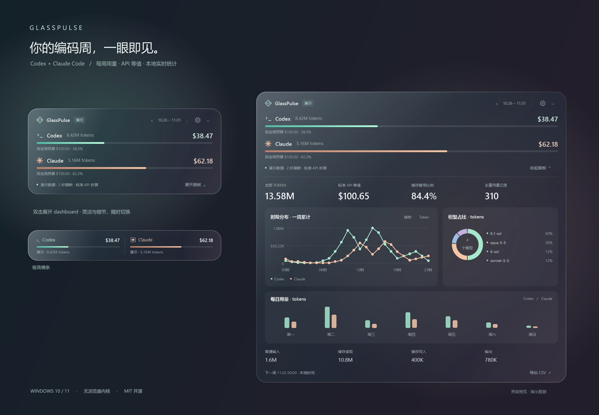

# GlassPulse

[简体中文](README.zh-CN.md) · English

A small glass desktop meter for your coding week. Track **Codex + Claude Code tokens and their standard API dollar equivalent**, then double-click to unfold the dashboard.



## A quiet meter, with detail when you need it

- **Compact by default.** Two progress bars, mint for Codex and peach for Claude. An optional mini bar takes even less room.
- **Double-click to expand.** Hourly or daily line charts, daily grouped bars, a model-share donut, cache reuse and token breakdowns. Switch the time charts between tokens and USD; hover for values.
- **Calendar weeks.** Local time, Monday or Sunday start, automatic rollover and up to 52 selectable weeks while the source logs remain available.
- **Live local updates.** A two-second refresh by default; only new log bytes are read after the first scan. Usage appears after the coding tool writes its completed usage record.
- **Native Windows.** C# / WPF on .NET Framework 4.8. No Electron, WebView, Node.js or background web server in the running application. The executable is about 150 KB; Windows supplies the runtime.
- **Desktop controls.** Drag, edge snap, always on top, adjustable glass opacity, tray, optional mouse passthrough and optional login startup. `Ctrl+Alt+G` shows/hides the meter when the shortcut is available.
- **Offline and private.** The application makes no network requests, requests no API keys and stores no conversation copies. Export the selected week's daily aggregates as CSV.

The UI currently uses Simplified Chinese; the source and documentation are available in English and Chinese.

## Run

Download `GlassPulse.exe` from this repository's Releases section, or build it below. Double-click the executable. There is no installer and administrator rights are not required.

Requirements: Windows 10/11 with .NET Framework 4.8 and local Codex or Claude Code usage logs. Windows x64 is the tested configuration. Native blur depends on Windows composition; the translucent surface remains usable if blur is unavailable.

| Interaction | Result |
| --- | --- |
| Double-click the background | Expand/collapse the dashboard |
| Double-click the mini bar | Open the dashboard |
| Drag the background | Move and snap near a screen edge |
| Gear button / right-click / tray | Settings and view options |
| `‹` / `›` | Browse weeks |
| `−` or `Esc` | Hide to tray; collection continues |
| `Ctrl+Alt+G` | Show/hide; also restores mouse interaction |
| Tray → Restore mouse interaction | Recover from passthrough or a shortcut conflict |
| `F5` | Refresh now |
| Tray → Exit | Quit completely |

### What the bars and dollars mean

Each bar shows **priced usage / your own weekly API-equivalent budget**. The default budget is $100 per provider, adjustable in Settings. A value above 100% keeps the bar full and displays the actual percentage.

The bars do not represent an official subscription quota. Dollars are a **standard, global API token-price estimate**, not the amount charged for your subscription. Fast/priority premiums, regional premiums, tool calls, taxes, discounts and provider-specific billing adjustments are excluded. Supported long-context tiers are applied per recorded request.

Unknown models retain their tokens. Their missing costs are disclosed and the priced subtotal is prefixed with `≥`. Old Claude logs without cache TTL details use the short cache-write rate and show an estimate notice. Reasoning tokens already included in output are counted once.

### Data sources

| Tool | Default source |
| --- | --- |
| Codex CLI / desktop sessions | `%USERPROFILE%\.codex\sessions\**\*.jsonl` |
| Archived Codex sessions | `%USERPROFILE%\.codex\archived_sessions\**\*.jsonl` |
| Claude Code, including subagent logs | `%USERPROFILE%\.claude\projects\**\*.jsonl` |

`CODEX_HOME` and `CLAUDE_CONFIG_DIR` are honored as defaults. Override either tool's **home directory** in Settings. WSL logs can be selected by their accessible Windows path. Plain Claude web/desktop chats and activity on other devices or cloud hosts are only included if compatible usage logs are present in the selected directories.

Numbers are reconstructed from the available logs. Deleting logs removes their contribution; keeping them retains history. Malformed, inaccessible or missing sources are marked. The reader handles partial UTF-8 lines, active writers, appended files and truncation. Modern Codex response IDs and Claude message/request IDs prevent double counting; legacy Codex counters are reconciled with modern response records.

### Settings and prices

Runtime configuration is stored in a `data` folder beside the executable. For example, `GlassPulse.exe` uses `data`; moving the application folder moves its configuration too. It does not install application data on the system drive:

```text
settings.json   # appearance, budgets, source directories and position
pricing.json    # editable price snapshot; USD per million tokens
```

Settings → Edit price catalog opens your active `pricing.json`. Save the file and the next refresh revalues the loaded history. Invalid edits leave the last valid catalog active with a warning. The initial snapshot was checked on **2026-10-27** and contains 29 model entries. The app does not download price updates automatically; calendar weeks roll over automatically regardless of catalog updates. When upgrading the app, an existing user-edited catalog is preserved.

Official sources: [OpenAI pricing](https://developers.openai.com/api/docs/pricing), [GPT-6.1 Sol context pricing](https://developers.openai.com/api/docs/models/gpt-6.1-sol), [Claude pricing](https://platform.claude.com/docs/en/about-claude/pricing). All source URLs are also recorded in the catalog.

For an alternate configuration directory:

```powershell
.\GlassPulse.exe --data-dir "data"
```

## Build and test

On Windows, using Windows PowerShell 5.1 or PowerShell 7:

```powershell
.\build.ps1 -Test
```

The script uses the Windows .NET Framework C# compiler. No SDK download, NuGet restore or paid service is required. Output: `dist\GlassPulse.exe`. Tests cover deduplication, incremental log reading, cache billing, model aliases, unknown prices, long context and DST/week boundaries.

Generate previews using synthetic data:

```powershell
$exe = (Resolve-Path .\dist\GlassPulse.exe).Path
Start-Process $exe -ArgumentList '--preview build\preview --data-dir build\preview-data' -Wait
Start-Process $exe -ArgumentList '--smoke --data-dir build\smoke-data' -Wait
```

Use absolute output paths when running the commands from a different working directory. Preview files contain only demonstration data. `--report <path>` performs two scans and writes aggregate diagnostics to a local JSON file; diagnostics should stay private.

## Project structure

```text
src/                 native UI, charts, log reader and accounting
tests/CoreTests.cs   standalone accounting/reader scenario suite
pricing.json         versioned price snapshot with official sources
assets/              icon and synthetic-data screenshots
docs/                specification and release notes
build.ps1            dependency-free Windows build and tests
package.ps1          portable ZIP and SHA-256 manifest
publish.ps1          publish this new repository using an authenticated gh CLI
.github/workflows/   Windows CI and tagged releases
```

## Related projects

| Project | Useful if you prefer |
| --- | --- |
| [ccusage](https://github.com/ccusage/ccusage) | Rich CLI token/cost reports from local agent data |
| [codex-bar](https://github.com/jspann21/codex-bar) | A small Windows widget focused on official Codex weekly capacity |
| [CodexWinBar](https://github.com/ItayCohen-Prog/CodexWinBar) | A Windows taskbar companion with provider quota integrations |

GlassPulse uses its own native implementation, focused on a glass floating meter and local token analytics. No source code from those projects is bundled.

## License

[MIT](LICENSE).
