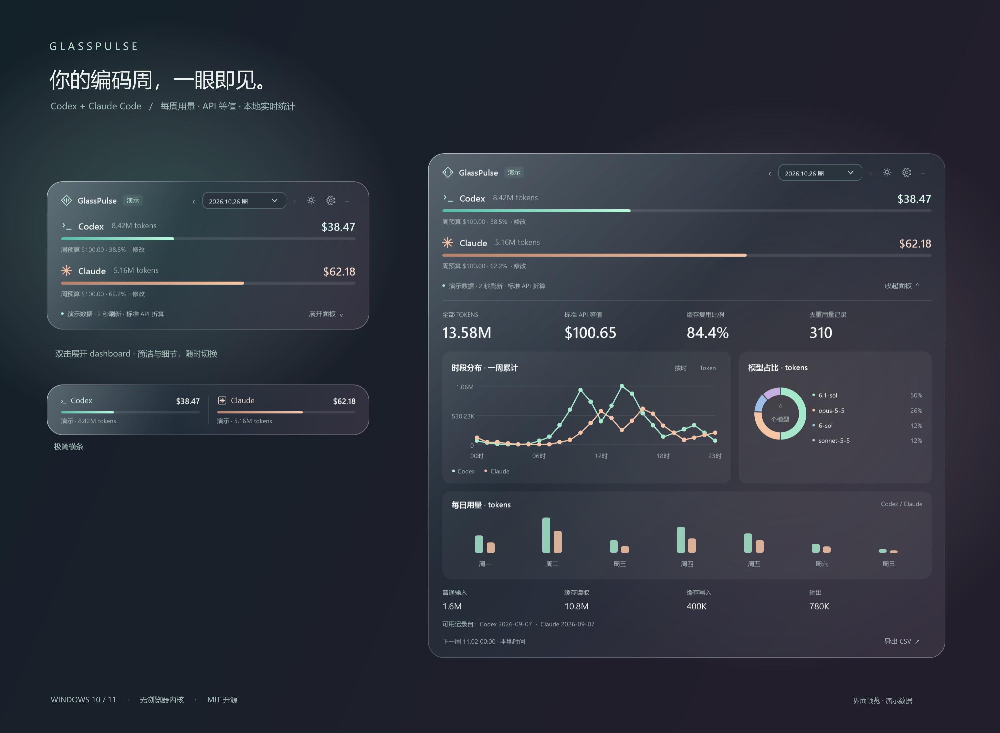

# GlassPulse

�������� �� [English](README.md)

������������������ͳ�� **Codex / Claude Code �� token��ÿ�� API ��ֵ����**��˫��չ�����ӻ���塣



## �������ʾ���ݶ���ѡ��

- **dzɫ / ��ɫ����**�����̫����ť�������������л�������������������ҳͬ����ɫ��
- **�� Codex���� Claude��ͬʱ��ʾ**��ͨ�����û��Ҽ�ѡ�������С�ͼ�������ܺ� CSV ����ѡ��仯��
- **Ĭ������**��˫��չ�� dashboard������ģʽѡ�񵥸����ߺ������Ϊ������
- **����������Ԥ��**�����Ԥ������ֱ���޸ġ�Ĭ�ϲ������ޣ�0 ��ʾ������Ԥ�㣻��ʱ����ʾ token �ͽ�Ԥ����������ա�
- **ֱ��ѡ����ʷ��**�������������г�������־���ǵ�ȫ���ܣ����ע������������������ڡ�
- **ԭ��Բ�DZ߽�**������Ͷ����IJ����ϳɲ㹲��Բ��������չ�������š��ƶ�������ʱͬ���Ӿ���ԭ���ü���ǰ������ʹ����������ģ����
- **Ĭ�� 2 ��ˢ��**���״�ɨ������ȡ�������֣����빤��д��������¼�������ʾ��


## ���������

�ӱ��ֿ� Releases ���� `GlassPulse.exe`�������ر�Я ZIP ����ѹ�����С��ⰲװ������Ҫ����ԱȨ�޻� API Key��

��Ҫ Windows 10 1903 ����°汾 / Windows 11 �� .NET Framework 4.8��ʹ���������п⣬������������ںˡ�����֤ Windows x64��ԭ��ģ��ȡ���� Windows �ϳ�����ģ��������ʱ�Ա���͸����ʾ��

| ���� | ���� |
| --- | --- |
| ˫���հ״� | չ�� / ���� dashboard |
| ˫�������� | չ�� dashboard |
| ���Ԥ������ | �޸Ķ�Ӧ���ߵ���Ԥ�� |
| ̫����ť | �л�dzɫ / ��ɫ |
| ���������� | ѡ����һ������ʷ�� |
| �Ҽ� / ���� | ѡ����ʾ�Ĺ��ߡ�������� |
| �϶��հ״� | �ƶ���������Ļ��Ե |
| `?` / `Esc` | ���ص����̣�����ͳ�� |
| `Ctrl+Alt+G` | ��ݼ�����ʱ���� / ���أ����ָ���꽻�� |
| ���� �� �ָ���꽻�� | �˳���괩͸����Ӧ�Կ�ݼ���ͻ |
| `F5` | ����ˢ�� |
| ���� �� �˳� | ��ȫ�˳� |

## ͼ����Ƽ�

��������Сʱ / �������ߡ�ÿ�ղ�����״ͼ��ģ�� token ��ͼ�����渴���� token ���ࡣʱ��ͼ���л� token / ��Ԫ����ͣ�鿴��ֵ��Ҳ�ɵ�����ѡ���ߵ�ÿ�ջ��� CSV��

Ԥ�������㷽ʽΪ��**�Ѷ��۵� API ��ֵ���� �� �Լ����õ���Ԥ��**���ײ͹ٷ�ʣ������鿴�ṩ�̵�����ҳ��

����׼��ȫ�� API token �������㣬֧�����г��Ļ���ͳ������ĵ�λ����ǰ�۸��������������ѡ��ʷ�ܣ����������� / ����ģʽ�������Ӽۡ����߷ѡ�˰�ѻ��˻��ۿۡ�

δ֪�۸��Ա��� token��ȫ��δ����ʱ��ʾ�������ۡ��������Ѷ���ʱ���� `��`���� Claude ��־δ��¼����ʱ��ʱ�����ڻ���д����㲢��ʾ������Ѿ����������� token ֻ��һ�Σ�Claude �ظ����ȥ�ء�Codex ʹ�ù淶����������������δ�ƽ����ۼƿ��ռ����Ƶĸ��Ự��ʷ��������δ���ۼƿ��ո��ǵ���ȷ�������������󣬲�������Ԫ��������һ�Ρ��ڲ������� ccusage �ο�ʱ���߹��㲢������

## ������������ʷ��Χ

�Զ����ֹ�����Ŀ¼��֧�� `CODEX_HOME`��`CLAUDE_CONFIG_DIR`��Ҳ����������ָ����Ŀ¼����ȡ Codex ��ͨ�� Zstandard ѹ���ĻỰ / �鵵��־���Լ� Claude Code ��Ŀ���Ӵ��� JSONL��ͬ����ͨ�ļ��ͻĿ¼�������ȣ�ѹ����ʷ������ʽ���룬δ�仯���ļ����ظ���ȡ��

��ʷ��Χȡ���ڱ����Ա�������־����ͨ��ҳ���졢�����豸���ƶ˻����Ҫ��Ӧ������־�Ż���롣��ɾ����Դ��־�޷�ƾ�ջָ���ȱʧ����Դ���쳣��¼����ʾ������е�����������ڿɰ������֡�û�м�¼���롸����Ϊ�㡹��

����Ĭ�ϱ�����**�����Ե� `data` �ļ���**������ `settings.json` �� `pricing.json`���ƶ����������ļ��м��ɴ������ã�������ϵͳ�̰�װӦ�����ݡ�Ҳ��ʹ���������Ŀ¼��

```powershell
.\GlassPulse.exe --data-dir ".\my-data"
```

�۸���� 32 ����Ŀ����������Ϊ 2026-11-13�����ñ��ؿ��ա��Ѽ��� Claude Fable 5.2 �� Mythos 5.2��ÿ���� token �ı�׼�۸�Ϊ���� $8����� $40�������ȡ $0.20��5 ���ӻ���д�� $10��1 Сʱ����д�� $16������ 1M ������ʹ����ͬ���ۣ�5 �� 5.1 �汾�������Լ۸������Ჹ��ȱʧ������ģ�ͣ�ͬʱ�����ѱ༭�ĵ��ۣ���ͨ�����༭�۸�����޸�������Ŀ����Ȼ�ܻ��Զ��л������۲����Զ��������ء�

�ٷ���Դ��[OpenAI ����](https://developers.openai.com/api/docs/pricing)��[�� Sol ģ�Ͷ���](https://developers.openai.com/api/docs/models/gpt-5.6-sol)��[Claude ����](https://platform.claude.com/docs/en/about-claude/pricing)���۸��Ҳ������Դ���ӡ�

## ��˽����������֤

�����������������󣬲�����Ի��������������á�������־�����ݿ⡢��Ϻ�ƾ�ݾ��ų��ڰ汾���Ƽ�������֮�⡣������ͼֻʹ����ʾ���ݣ���չʾ��������·����

```powershell
.\build.ps1 -Test
.\package.ps1 -SkipBuild
```

ʹ�� Windows �Դ��� .NET Framework ���������������� SDK ��ԭ NuGet����֤���� 64 ������ / ���ó������Լ��������⡢��������ѡ���������ͼ��ϵ� 18 ��ԭ�����ڼ�顣

����������`--preview <Ŀ¼>` ������ʾԤ����`--smoke` ���ͼ�������ã�`--report <�ļ�>` ������ػ�����ϡ����� `--data-dir` ָ�����ǵı�Я����λ�á���ϱ����뱣���ڱ�����

## ��ع���������֤

[ccusage](https://github.com/ccusage/ccusage) �ʺ� CLI ���棬[codex-bar](https://github.com/jspann21/codex-bar) ���� Codex ��������[CodexWinBar](https://github.com/ItayCohen-Prog/CodexWinBar) �ṩ��������ȼ��ɡ�GlassPulse ʹ���Լ���ԭ��ʵ�֡�

[MIT ����֤](LICENSE)��\nʵ�����ػع飺`./scripts/test-pixel-edges.ps1` ʹ�����ɵ����̱����������⡢���ߡ���ͼ���ƶ�״̬�� 24 ����������ؼ���Ե����ȷ�ϲ����ϳ������ã�������������档���߱��ɼ���������Ļ����ᱨ���޷���⣬��������ͨ��������ʹ�� Windows �����������֧��ʱ����Ϊ͸����\n
ѹ����ʷʹ����Ƕ���̶��汾�� Zstandard ��������BSD-3-Clause����У�����ͷŵ���Я�� `data/native` Ŀ¼�����в����� Python �� ccusage���״�����ɨ��ѹ���鵵��Ҫ����ʱ�䣬֮������ˢ�¡���ǰ������Ϊ Windows x64���μ�[����������](THIRD_PARTY_NOTICES.md)��

�Ѱ���ͬ���ڡ�ʱ��������ʼ�պͱ�׼ API �۸��� ccusage 20.0.40 �����ĸ����������ܣ����롢���桢������� token ����ʾ����һ�¡��Զ��嵥�ۡ�ʱ������ / Flex ��λ��ͬ��Ӱ������ʵ���������汣���ڱ������ֿ�ֻ������ʾ���������һ���Խ����
